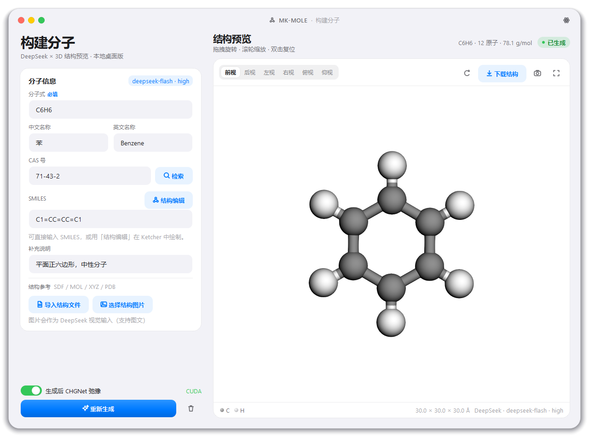
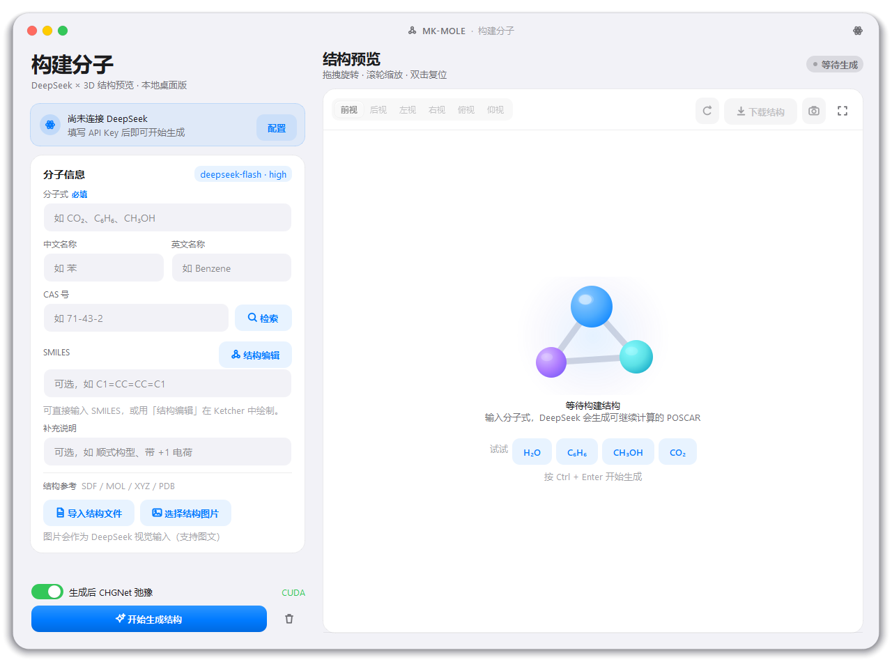
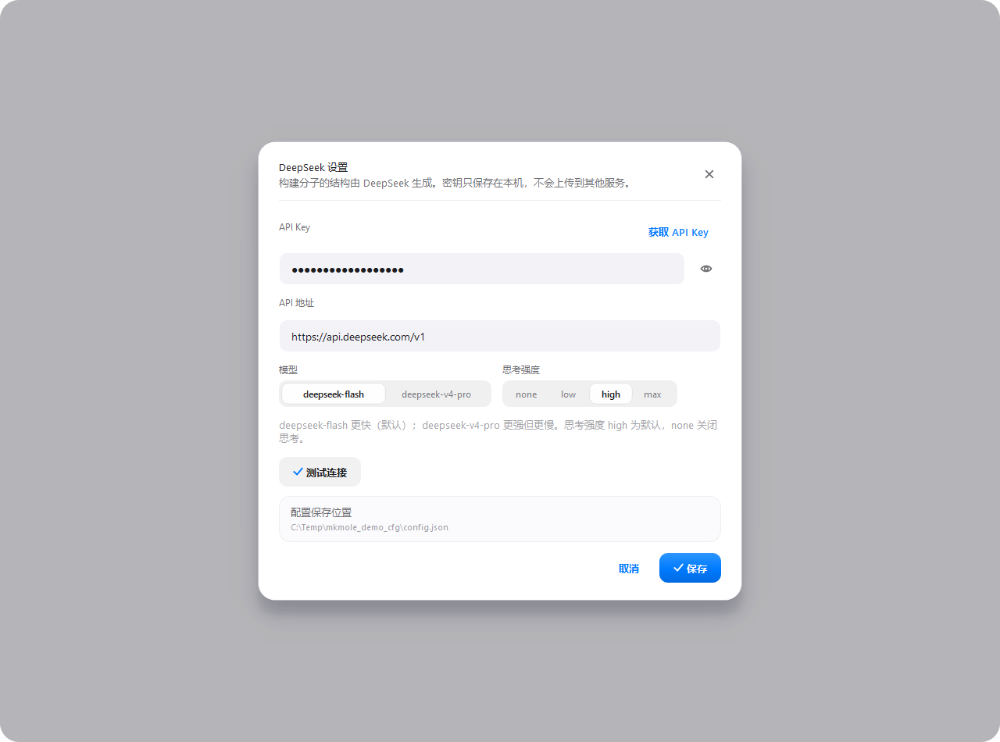
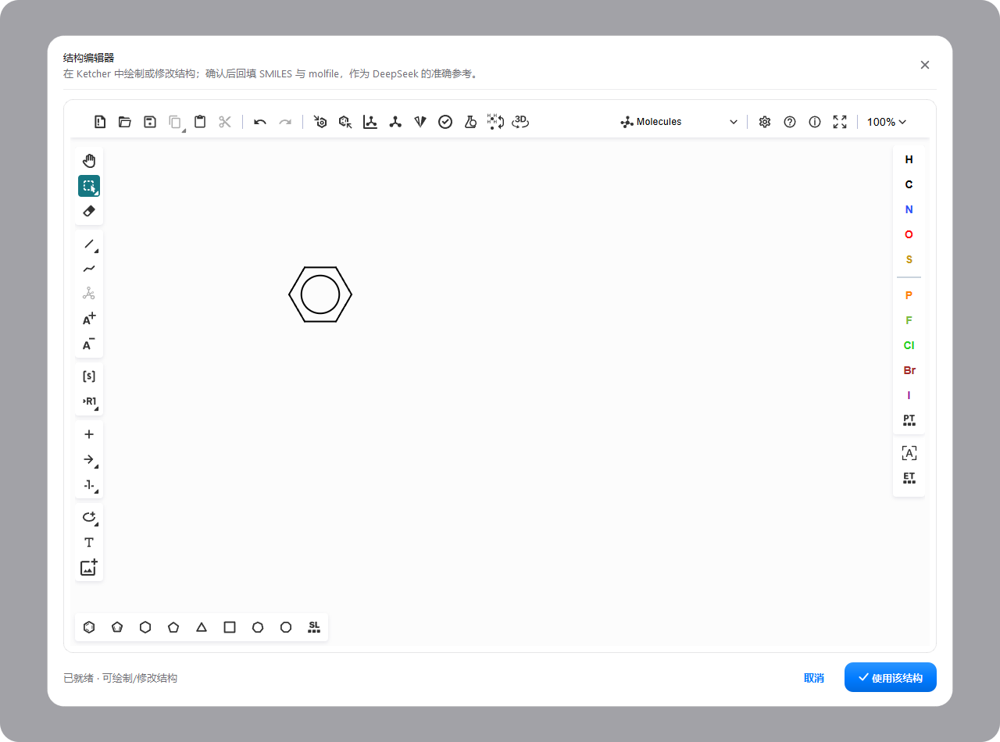
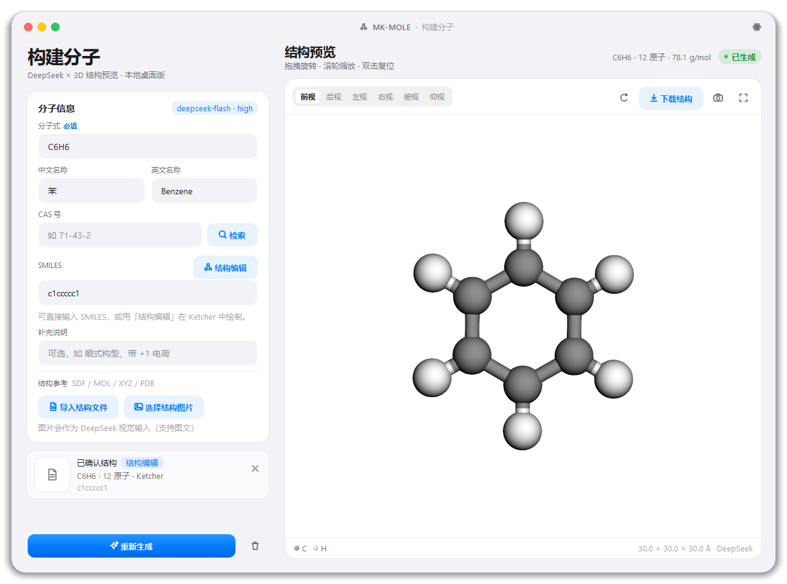
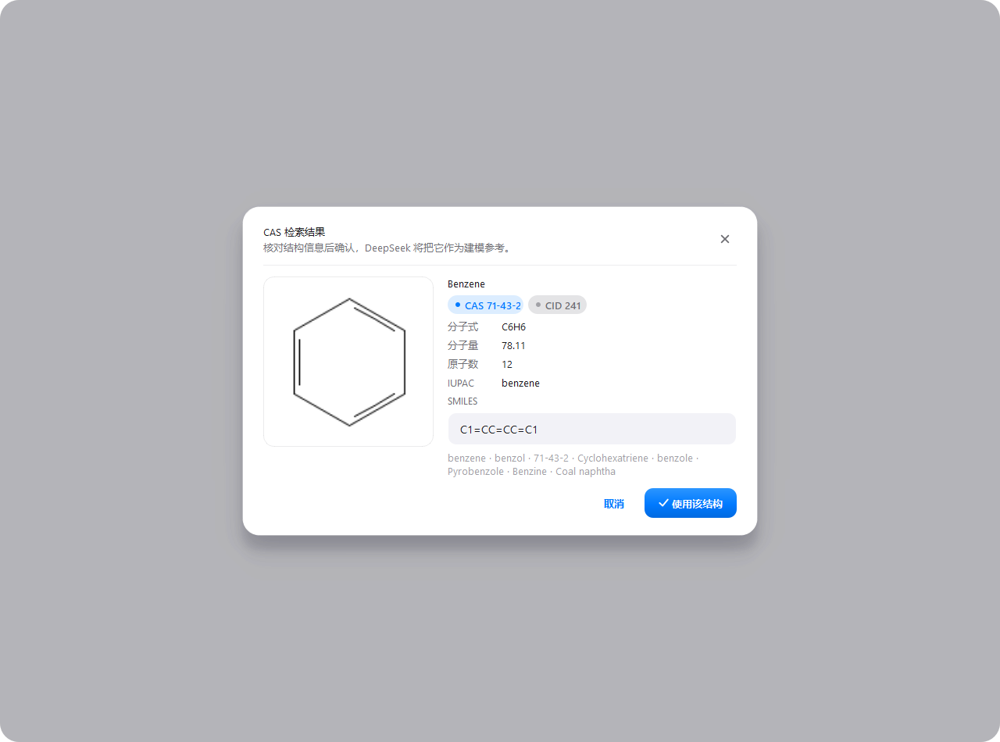
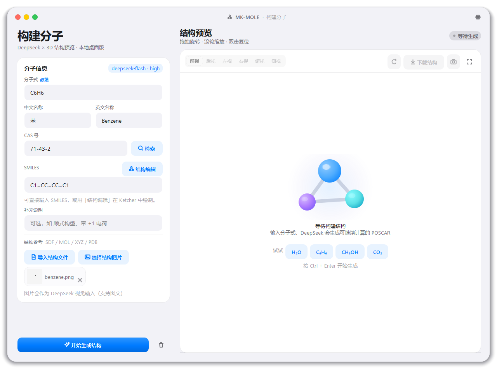
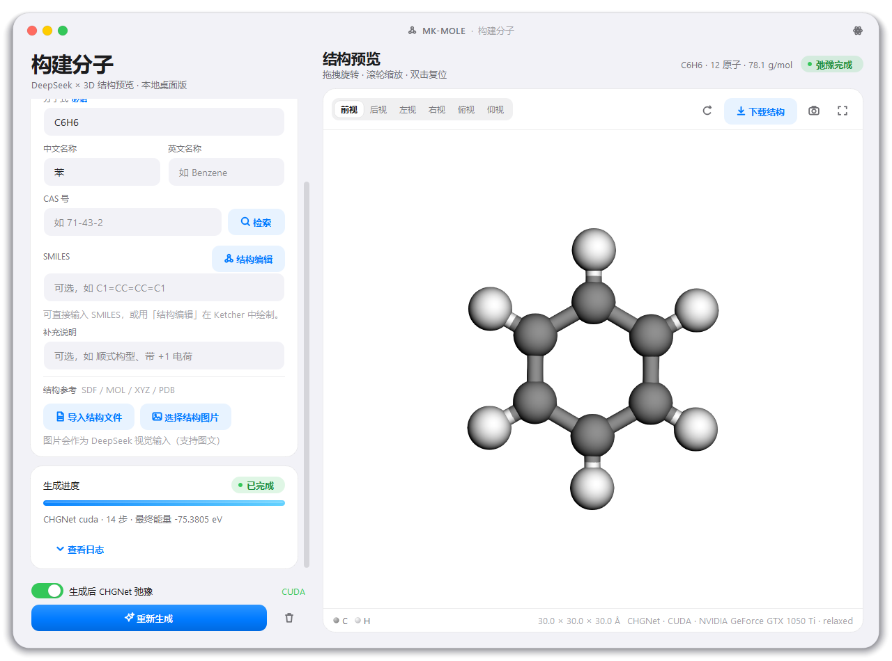
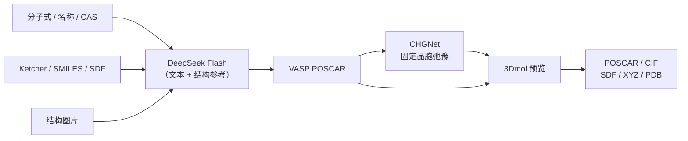

<div align="center">

# ⚛️ BuildMolecule <sub>MK-MOLE</sub>

**iOS 风格的本地分子构建器 · DeepSeek 生成 · CHGNet 弛豫 · 3D 预览**

在桌面上输入分子式 / SMILES / 结构图片 / SDF，或直接在 **Ketcher** 中绘制结构；
DeepSeek 生成 VASP POSCAR，CHGNet 快速弛豫，3Dmol 本地预览，一键导出
**POSCAR / CIF / SDF / XYZ / PDB**。

[](https://github.com/moyulyy/BuildMolecule/releases/latest)
[](https://www.python.org/)
[](https://doc.qt.io/qtforpython/)
[](https://api-docs.deepseek.com/)
[](https://github.com/CederGroupHub/chgnet)
[](#-下载与安装)
[](LICENSE)

<a href="https://github.com/moyulyy/BuildMolecule/releases/latest"><b>⬇️ 下载 Windows 便携版</b></a>
·
<a href="#-快速开始">快速开始</a>
·
<a href="#-截图">界面截图</a>
·
<a href="#-chgnet-弛豫">CHGNet</a>

</div>

---

## ✨ 为什么是 BuildMolecule？

> **从一句话到一个可计算结构。**  
> 不用在网页、化学编辑器、LLM 对话和晶体软件之间来回切换。  
> 在一个本地窗口里完成：**描述 → 生成 → 编辑 → 弛豫 → 查看 → 导出**。

| | |
|---|---|
| 🧠 **DeepSeek 原生集成** | 默认 `deepseek-flash` + `reasoning_effort=high`；流式显示思考过程，支持 `deepseek-v4-pro`、`none/low/high/max` 思考强度、取消与自动重试。 |
| ✏️ **Ketcher 结构编辑** | 内置自托管 Ketcher 3.4；确认后自动回填 SMILES、molfile、分子式和原子数，作为 LLM 的精确连接表参考。 |
| 🧠 **CHGNet 快速弛豫** | 生成后默认自动弛豫（固定晶胞）；独立 `chgnet_env`，自动检测 CUDA / CPU，支持取消，结果可继续导出。 |
| 🖼️ **多模态输入** | 分子式、名称、CAS、SMILES、SDF/MOL/XYZ/PDB、结构图片（PNG/JPG/WebP/BMP）。 |
| 🔎 **CAS 检索** | PubChem 查询 CID、分子式、分子量、IUPAC、别名、SMILES 与二维结构图。 |
| 🎨 **本地 3D 预览** | 3Dmol.js 球棍模型、Jmol 配色、悬停元素标签、六向视角、保存当前视角 PNG。 |
| 📦 **多格式导出** | POSCAR、CIF、SDF、XYZ、PDB；弛豫后下载的是 CHGNet 优化结构。 |
| 🍎 **iOS 审美** | 无边框圆角窗口、交通灯、卡片、分段控件、渐变按钮、活动指示器、Toast 与轻量动画。 |
| 🖥️ **桌面体验** | 无控制台启动、任务栏图标、标题栏拖拽、边缘缩放、F11 沉浸模式、`Ctrl + Enter` 生成。 |
| 🔒 **本地优先** | 配置/缓存放在便携 `data/` 目录；不经过任何中转服务；CHGNet 在本机 GPU/CPU 运行。 |

---

## 🖼️ 截图

<p align="center">
  
</p>

| 空状态 / 首次启动 | DeepSeek 设置 |
| :---: | :---: |
|  |  |

| Ketcher 结构编辑 | 编辑器结果回填 |
| :---: | :---: |
|  |  |

| CAS 检索 | 结构图片输入 |
| :---: | :---: |
|  |  |

<p align="center">
  <b>CHGNet 弛豫完成</b><br>
  
</p>

> 截图中 API Key 为演示值；仓库不包含任何真实密钥。

---

## 🚀 快速开始

### 方式 A · 下载便携版（推荐，Windows 10/11）

1. 打开 [**Latest Release**](https://github.com/moyulyy/BuildMolecule/releases/latest)。
2. 下载并解压 `BuildMolecule-portable-win64-v*.zip`。
3. 双击 `MK-MOLE.exe`（无控制台窗口）。
4. 点击右上角原子图标 → 填写 DeepSeek API Key。
5. 可选：运行 `install_chgnet.bat` 启用 CHGNet 弛豫（会自动检测 GPU/CUDA）。

> Release 中的便携包是 **GUI 本体**；CHGNet/PyTorch 环境体积大且与显卡/CUDA 相关，不随包上传。  
> `install_chgnet.bat` 会在同目录创建 `chgnet_env`，安装完成后应用自动识别。

### 方式 B · 源码运行

```bash
git clone https://github.com/moyulyy/BuildMolecule.git
cd BuildMolecule

python -m venv .venv
# Windows
.venv\Scripts\activate
# macOS / Linux
source .venv/bin/activate

pip install -r requirements.txt
python main.py          # 调试入口（带控制台）
```

Windows 日常启动：双击 `MK-MOLE.vbs`（完全无黑框）或 `run.bat`；  
macOS / Linux：`./run.sh`。

### 环境要求

- Python **3.10+**（已在 Windows + Python 3.14.7 + PySide6 6.12 验证）
- PySide6 的 QtWebEngine（`pip install -r requirements.txt` 已包含）
- 网络访问 `api.deepseek.com` 与 `pubchem.ncbi.nlm.nih.gov`

---

## 🔑 配置 DeepSeek

打开 **原子图标 → DeepSeek 设置**：

| 配置 | 说明 |
|---|---|
| API Key | 在 [platform.deepseek.com/api_keys](https://platform.deepseek.com/api_keys) 获取 |
| API 地址 | 默认 `https://api.deepseek.com/v1` |
| 模型 | `deepseek-flash`（默认，快）/ `deepseek-v4-pro`（更强） |
| 思考强度 | `none` / `low` / **`high`（默认）** / `max` |
| 测试连接 | 调用 `/models` 验证 Key、网络与模型名 |

也可用环境变量兜底：

```bash
DEEPSEEK_API_KEY=sk-...
DEEPSEEK_BASE_URL=https://api.deepseek.com/v1
DEEPSEEK_MODEL=deepseek-flash
DEEPSEEK_REASONING_EFFORT=high
```

配置默认保存在：

```text
源码运行：      BuildMolecule/data/config.json
便携版：        <MK-MOLE.exe 所在目录>/data/config.json
自定义：        MK_MOLE_DATA_DIR 指定的目录
```

> ⚠️ API Key 以明文保存在本机 `data/config.json`；请勿提交或外发该目录。`data/` 已在 `.gitignore` 中。

---

## 🧭 使用流程

1. **分子式**（必填）：`C6H6`、`H2O`、`CH3OH`，支持 `C₆H₆` 下标。
2. 可选填中文名、英文名、CAS 号、补充说明。
3. **CAS 检索**：确认 PubChem 的二维结构、SMILES 和原子数。
4. **结构编辑**：Ketcher 中绘制/修改，确认后回填 SMILES + molfile。
5. **结构图片 / 结构文件**：上传参考图（自动缩放为视觉输入）或 SDF/MOL/XYZ/PDB。
6. **生成后 CHGNet 弛豫** 默认开启，可关闭。
7. 点击 **开始生成结构** 或 `Ctrl + Enter`：
   - DeepSeek 流式生成 POSCAR；
   - 立即显示初始结构；
   - 自动进入 CHGNet 固定晶胞弛豫；
   - 可随时 **取消生成 / 取消弛豫**；
   - 失败或取消保留初始结构。
8. **下载结构**：POSCAR / CIF / SDF / XYZ / PDB；弛豫成功时导出弛豫后结构。

### 快捷键

| 快捷键 | 功能 |
|---|---|
| `Ctrl + Enter` | 开始生成 / 取消生成或弛豫 |
| `F11` | 沉浸模式 |
| `Esc` | 退出沉浸模式 |
| 双击标题栏 | 最大化 / 还原 |
| 双击 3D 视图 | 重置视角 |

---

## 🧠 CHGNet 弛豫

CHGNet 作为**独立 Python 环境**运行，GUI 进程保持轻量、快速启动。

### 安装

```bat
install_chgnet.bat
```

脚本自动：

1. 查找 Python 3.10–3.12（优先 Miniconda，避免 Python 3.14 torch wheel 缺失）；
2. 调用 `nvidia-smi` 检测 GPU/CUDA；
3. 有 NVIDIA GPU → 安装 **CUDA 12.1 PyTorch**；无 GPU → 安装 CPU PyTorch；
4. 安装 `chgnet`、`pymatgen`、`ase`；
5. 验证 `torch.cuda.is_available()`；
6. 在脚本目录创建 `chgnet_env` 并写入 `data/chgnet_python.txt`。

应用自动检测顺序：

```text
MK_MOLE_CHGNET_PYTHON
data/chgnet_python.txt
<app>/chgnet_env/Scripts/python.exe
<app>/.venv-chgnet/Scripts/python.exe
```

未安装时开关仍保持默认勾选，但会在生成后提示并跳过弛豫；点击开关旁的 **检测** 可重新识别。

### 运行参数

- 固定晶胞 `relax_cell=False`（参考 `chgnet-opt` 的 `relax-opt`）
- 默认 `max_steps=300`，`fmax=0.05 eV/Å`
- 高级参数可在 `data/config.json` 调整：`chgnet_max_steps`、`chgnet_fmax`
- 自动优先 CUDA，无 GPU 回退 CPU
- 子进程运行，支持终止取消；结果写入 `CONTCAR`，回到 3D 视图

> CHGNet 主要面向晶体/周期性体系；对孤立分子的结果适合做**快速预弛豫**，正式发表前仍建议使用目标泛函做 DFT 优化与频率校验。

---

## 🔬 工作流



### 输入优先级

系统提示词明确要求 DeepSeek 按以下优先级建模：

```text
结构编辑器 / 结构文件的 molfile、SMILES
        >
结构图片
        >
名称 / CAS / 分子式 / 补充说明
```

并强制自检：原子守恒、元素行/数目行、连接性/价态、立体化学、30 Å 盒子居中、唯一 POSCAR。

---

## 📦 结构与导出

- 分子放入 **30 × 30 × 30 Å** 立方真空盒，几何中心位于盒心。
- 只接受元素行 / 数目行 / 坐标行完全自洽的 POSCAR；缺少时自动关闭思考模式重试一次。
- 组成与输入不一致时显示橙色警告，但保留结构供核对。
- 渲染用 SDF 由 POSCAR 按共价半径推断成键；**导出的 POSCAR 保留模型原始文本**。
- 导出格式：`POSCAR` / `CIF` / `SDF` / `XYZ` / `PDB`；可保存当前视角 PNG。
- CHGNet 成功后，下载内容切换为弛豫后结构。

---

## 🗂️ 项目结构

```text
BuildMolecule/
├── main.py / main.pyw          # 调试 / 无控制台入口
├── run.bat / run.sh            # 便捷启动
├── MK-MOLE.vbs                 # Windows 无黑框启动
├── build_exe.bat / MK-MOLE.spec# PyInstaller onedir 构建
├── install_chgnet.bat          # GPU/CUDA 检测 + CHGNet 安装
├── requirements*.txt
├── mk_mole/
│   ├── app.py                  # QApplication / 窗口装配 / AppUserModelID
│   ├── config.py               # 便携 data/ 配置与旧配置迁移
│   ├── theme.py                # iOS 配色、字体、全局 QSS
│   ├── assets/                 # 3Dmol、viewer、图标、Ketcher
│   ├── services/               # DeepSeek、POSCAR、PubChem、图片、CHGNet
│   ├── tools/                  # 独立 CHGNet probe / runner
│   ├── views/                  # 主页面、弹层、Ketcher 编辑器
│   └── widgets/                # 无边框窗口、自绘控件、3D 查看器
├── tests/                      # 23 项离线测试
├── docs/                       # README 截图
├── data/                       # 运行时配置/缓存（gitignored）
└── dist/                       # 便携构建输出（gitignored）
```

---

## ✅ 测试

```bash
pip install -r requirements-dev.txt
python -m pytest tests/ -q          # 23 passed
python -m pyflakes mk_mole tests main.py main.pyw
```

覆盖：POSCAR 提取/居中/导出、组成告警、DeepSeek mock SSE/图片消息/提示词、便携配置、图片编码、molfile 摘要、CHGNet 环境候选、关闭按钮事件等。

---

## ⚠️ 已知限制

- **不执行 DFT**：生成初始结构并做 CHGNet 快速弛豫；不含 VASP 静态计算、Bader、DOS、频率。
- **CHGNet 适用性**：主要面向晶体/周期性体系；孤立分子结果仅作预弛豫参考。
- **LLM 可能出错**：DeepSeek 仍可能生成不合理价键或原子数；界面会提示组成不一致，请人工核对。
- **图片识别不确定性**：手绘/截图可能误读元素标签。
- **PubChem 匹配可能歧义**：同分异构体、盐、溶剂合物请核对。
- **大体系**：默认 65536 输出预算；原子数很多时可能被截断，可换 `deepseek-v4-pro` 或拆分。
- **CHGNet 环境较大**：CUDA PyTorch 安装包数 GB；Release 不内置 CHGNet 环境，按需安装。
- **未签名**：Windows 首次运行可能出现 SmartScreen 提示。

---

## 🔒 安全与隐私

- DeepSeek/PubChem 请求只从本机发出；CHGNet 完全本地运行。
- API Key 明文保存在 `data/config.json`，请勿提交、打包或共享该目录。
- 应用首次启动会将旧版 `%APPDATA%\MK-MOLE\config.json` 迁移到便携 `data/`（不删除旧文件）。
- 便携版数据目录包含密钥时，请勿外发整个文件夹。

---

## 🙏 致谢

- [**Ketcher**](https://github.com/epam/ketcher) — Apache-2.0，结构编辑器。
- [**3Dmol.js**](https://github.com/3dmol/3Dmol.js) — BSD-3-Clause，3D 分子渲染。
- [**CHGNet**](https://github.com/CederGroupHub/chgnet) — 晶体图神经网络势函数。
- [**DeepSeek**](https://platform.deepseek.com/) — 结构生成 LLM。
- [**PubChem PUG REST**](https://pubchem.ncbi.nlm.nih.gov/docs/pug-rest) — CAS/化合物信息。
- [**Qt for Python (PySide6)**](https://doc.qt.io/qtforpython-6/) — 桌面框架。
- 界面与交互灵感来自 Web_Probe 的「构建分子」页面。

---

## 📄 License

本项目使用 **MIT License**，详见 [LICENSE](LICENSE)。  
第三方组件（Ketcher、3Dmol.js、CHGNet、Qt/PySide6）遵循各自上游许可。

<div align="center">

**BuildMolecule** · 从一个分子式，到下一个可计算结构。

</div>
